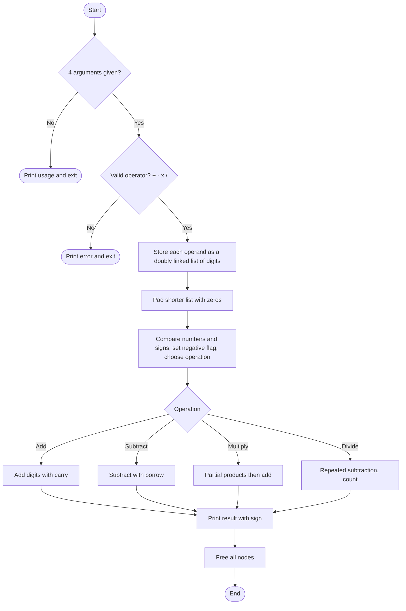

# Arbitrary Precision Calculator (APC) in C

A command-line calculator written in **C** that performs **addition, subtraction, multiplication and division on numbers of any length**, far beyond the range of `int` or `long long`. Each number is stored **digit by digit in a doubly linked list**, so the size is limited only by available memory.

> `./result.exe 123456789 x 987654321` → `121932631112635269`

---

## Table of Contents
- [Features](#features)
- [How to Run](#how-to-run)
- [How It Works](#how-it-works)
- [Flowchart](#flowchart)
- [Project Structure](#project-structure)
- [Input / Output](#input--output)
- [Module Details](#module-details)
- [Limitations](#limitations)
- [Future Improvements](#future-improvements)
- [Concepts Used](#concepts-used)
- [Author](#author)

---

## Features
- Works with **very large numbers** (not limited by `int` / `long` size)
- Supports `+`, `-`, `x` (multiply) and `/` (divide)
- Handles **negative numbers** for all four operations
- Digits stored in a **doubly linked list**, so the program can work from the last digit to the first
- Builds with a simple **Makefile**
- Frees all allocated memory after each calculation

---

## How to Run

**Requirements:** GCC and `make`

```bash
# 1. Build
make

# 2. Run: ./result.exe <operand> <operator> <operand>
./result.exe 123 + 456
./result.exe 1000 - 1
./result.exe 123456789 x 987654321
./result.exe 100 / 7
```

> **Use `x` for multiplication, not `*`.** The shell treats `*` as a wildcard and would replace it with file names.

**Operators**

| Operator | Meaning |
|---|---|
| `+` | Addition |
| `-` | Subtraction |
| `x` | Multiplication |
| `/` | Division (integer quotient) |

**Clean up**
```bash
make clear            # removes result.exe
rm -f *.o             # removes object files
```

**Windows:** run `result.exe 123 + 456` (no `./`).

---

## How It Works

1. **Input:** the two operands are read from `argv`. Each digit becomes one node of a doubly linked list (signs are skipped and remembered separately).
2. **Alignment:** for `+`, `-` and `/`, the shorter list is padded with leading zeros so both have equal length.
3. **Sign handling:** the program compares the numbers and the signs and picks the real operation, for example `5 + (-3)` becomes a subtraction. A negative flag decides the sign of the result.
4. **Operations (digit by digit, from the last node backward):**
   - **Add:** add digits with carry
   - **Subtract:** subtract the smaller from the larger, with borrow
   - **Multiply:** multiply by each digit of the second number, shift each partial product with trailing zeros, then add the partial products
   - **Divide:** subtract the divisor repeatedly and count the subtractions; the count is the quotient
5. **Output and cleanup:** the result list is printed and all nodes are freed.

---

## Flowchart



---

## Project Structure

```
apc-calculator/
├── calculator.c       # main(): argument checks, sign logic, operation dispatch
├── APC_header.h       # Node structure, Status enum, prototypes
├── inserting_fun.c    # Insert digits, free lists, compare, print, length
├── add_fun.c          # Addition
├── sub_fun.c          # Subtraction
├── mul_fun.c          # Multiplication
├── division_fun.c     # Division
├── makefile           # Build rules
└── README.md
```

---

## Input / Output

```
$ ./result.exe 123 + 456
Inserting successful
Addition successfully done
Result is 579

$ ./result.exe 999 + 1
Result is 1000

$ ./result.exe -5 + 3
Result is -2

$ ./result.exe 123456789 x 987654321
Result is 121932631112635269
Multiplication successfully done

$ ./result.exe 100 / 7
Result is : 14

$ ./result.exe -100 / 7
Result is : -14
```

**Usage message**
```
Please Pass Valid Arguments
Usage : result.exe operand operator operand
```

---

## Module Details

**Data structure**
```c
typedef struct node {
    struct node *prev;
    int data;          // one digit, 0 to 9
    struct node *next;
} cal;
```

- **`inserting_fun.c`**: `insert_args`, `insert_at_last`, `find_bigger`, `find_len`, `print_res`, `free_all`
- **`add_fun.c`**: `add` plus `add_res`, which inserts a digit at the front of the result list
- **`sub_fun.c`**: `sub`, which borrows from earlier digits
- **`mul_fun.c`**: `mul`, which builds partial products and adds them
- **`division_fun.c`**: `division`, which counts how many times the divisor can be subtracted
- **`calculator.c`**: validates input, decides the final sign and operation, calls the right function

---

## Limitations
- Integers only: division gives the **integer quotient** (no remainder or decimals)
- Division is done by repeated subtraction, so it is **slow when the quotient is very large**
- Multiplication must be typed as `x`
- Non-digit characters inside a number are silently ignored

---

## Future Improvements
- Handle **division by zero** with an error message
- Remove leading zeros from subtraction results (for example `100 - 99` prints `001`)
- Print the **remainder** (modulus) and support decimals
- Faster division using long division
- Validate operands and report invalid characters

---

## Concepts Used
- Doubly linked lists and traversal from both ends
- Dynamic memory allocation and freeing
- Arbitrary-precision arithmetic with carry and borrow
- Command-line arguments and input validation
- Multi-file C programs, header files and Makefiles

---

## Author
**Harsh Kadam**: Mechatronics Engineering student (MMIT, SPPU), interested in embedded systems, robotics, and semiconductors.

⭐ If you found this project useful, consider giving it a star!
